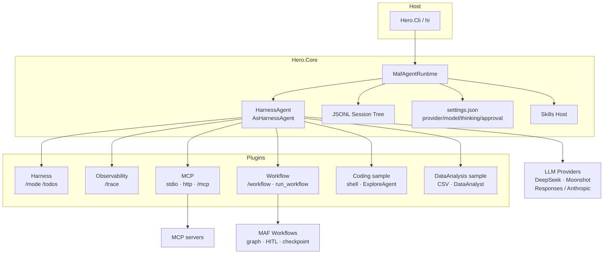
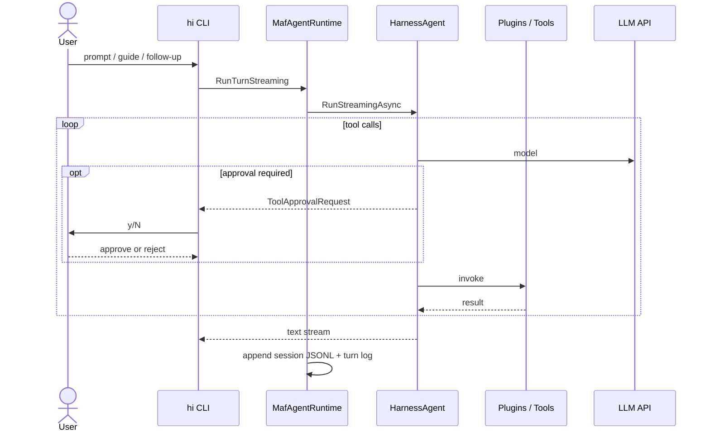
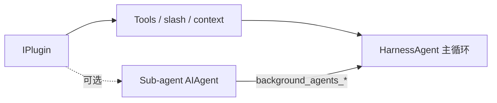

# HERO — Harness for Extensible Runtime Orchestration

[English](./README.md)

**HERO** = .NET 上一个**插件化的 Agent 运行时**：交互用 **MAF Harness Agent**，多步编排用 **MAF Workflows**，能力靠**插件**挂载，全程**可观测**。构建在微软官方 [Agent Framework](https://learn.microsoft.com/agent-framework/overview/agent-framework-overview) 之上——不自造 Agent 主循环，也不自造图编排引擎。

体验参考 [Pi](https://pi.dev/)；交互对话使用 [`AsHarnessAgent`](https://learn.microsoft.com/agent-framework/concepts/harness)，不复刻 Pi 的 TypeScript 运行时。控制台宿主为 `hi`。

**结构：** Core = 极简插座（会话 tip 树、约定提示、Skills、插件契约）；宿主只做展示与接线，编排留在 MAF。交互 REPL 用 Terminal.Gui；print/重定向路径用纯 Console（TTY 可着色）；`--json` 保持纯文本事件流。

## 能力一览

| 领域 | 当前能力 |
|------|------|
| 交互 Agent | MAF `AsHarnessAgent` — 工具、plan/todo/mode、loop、compaction |
| 多步编排 | MAF Workflows — `Plan → approve → Research(AIAgent) → Summarize`（`/workflow`、`run_workflow`） |
| HITL | 工具审批走 Harness `ToolApprovalAgent`；Workflow 计划审批走 `RequestPort` |
| 插件 | 运行时：Harness · Observability · MCP · Workflow · Sample：Coding · DataAnalysis |
| 可观测 | Turn 日志、`/trace`、HTML 导出、`--json` JSONL 事件流 |
| 会话 | JSONL tip 树、分支/checkout、续聊（`-c`）、导出 |
| Skills | Harness `AgentSkillsProvider` — 目录进上下文，正文经 `load_skill` 按需加载 |
| 文件记忆 | `~/.hero-agent/memory/<cwd-key>/`，Harness `file_memory_*`（按需；与 sessions/logs 同级） |
| 压缩 | 自动 `ContextWindowCompactionStrategy` + 手动 `/compact [turns]` |
| MCP | 官方 MCP 客户端（stdio / HTTP），失败静默降级 |
| 模型 | DeepSeek（OpenAI Responses）· Moonshot（Anthropic Messages）；`Chat:Protocol` |
| 安装 | `dotnet tool`（`hi`）· Docker（`-p` / `--json`） |

## 为什么做

CLI / 编码 Agent 需要的是**运行时**：挂工具、可恢复的会话树、每轮可观测、危险调用可审批、路径清晰时跑预定义多步图——而不是又一个聊天 Bot。HERO 是落在 .NET + MAF 上的宿主：用插件扩展能力，不必自造 Harness 或 Workflows。

## 设计取舍

| 选择 | 原因 |
|------|------|
| 构建在 MAF（Harness + Workflows）之上 | 开放对话用 Agent；预定义步骤用 Workflows——官方分工 |
| 官方 `AsHarnessAgent` | 复用 plan/todo/loop/compaction/工具审批，不自造主循环 |
| Workflow 不替代 REPL 循环 | Agent 回合是循环不是图；`/workflow` 是附加能力 |
| `~/.hero-agent/sessions/` 下 JSONL tip 树 | 对齐 Pi 式可分支历史，便于查看与导出 |
| API Key 永不落盘 | 仅环境变量或 `/model` 进程内存 |
| Core = 插座，插件 = 能力 | 可组合、可扩展 |

## 架构



### 一轮对话（简化）



**插件是组合，不是并列堆叠。** 插件贡献的一切都落在 Core 拥有的共享抽象上：同一个被装饰的 `IChatClient`、同一张工具表、同一条上下文管线、同一个会话与审批策略。正因为 Observability 包在 chat client 外层，它能观测到自己事先并不认识的子代理与 workflow 节点；正因为 MCP 工具在 warmup 阶段被发现，它们能在 agent 构建前被合入。多个能力因此合成**一个**交互主 Agent。

### 插件 ≠ Agent · 能力 ≠ 只有 Tools

插件是 **`IPlugin` 能力包**，不是 Agent。交互主 Agent 只有一个：**HarnessAgent**。插件通过 `IPluginBuilder` 往里挂贡献：

| 贡献 | 是什么 | 何时用 |
|------|------|------|
| `AddTool` | **主** Agent 可调用的函数 | 一次 tool / 主循环够用（`read_file`、`run_shell`、MCP、`run_workflow`） |
| `AddSlashCommand` | 给人用的 CLI（`/trace`、`/mcp`、`/workflow`） | 宿主 UX，不是模型工具 |
| `AddContextProvider` / `AppendInstructions` | 额外上下文或系统说明 | 环境块、插件提示 |
| `AddChatClientDecorator` | 包装 chat 管线 | 追踪、传输修正 |
| `AddSkillsRoot` | Skills 目录根 | 可选技能目录 |
| `AddSubAgent` | 额外 **`AIAgent`**（Harness BackgroundAgents） | 需要**另一套人设 + 工具子集 + 独立多步循环**，再把摘要交回父 Agent |

**经验法则：** 能写成一次 tool（或主 Agent 工具循环）→ 挂 Tool；只有要「专家角色、缩工具面、自己多步再交卷」才上 sub-agent（样例：**ExploreAgent**、**DataAnalyst**）。Observability / Harness / MCP 等常常**零**个子 Agent。



### 编排（Workflows）——有用到

HERO 故意用 **两种 MAF 编排**：

| 形态 | MAF 组件 | 在 HERO 里的角色 |
|------|------|------|
| 开放 / 交互 | **HarnessAgent**（agent loop） | REPL 回合、工具、工具 HITL、plan/todo、compaction |
| 预定义多步 | **Workflows**（`WorkflowBuilder` 图） | 可选图：`Plan → approve → Research → Summarize` |

Workflows **不是** REPL。由 Workflow 插件挂载：`.hero-agent/workflow.json` 设 `"enabled": true` 后，用 `/workflow <task>` 或工具 `run_workflow`。未启用 → 静默、不注册工具。图上的 HITL 走 Workflow `RequestPort`（计划 `y/N`），与工具审批 HITL 分开。

## Built on Microsoft Agent Framework

HERO 建立在微软官方 Agent 栈之上：编排留在 MAF，本仓库负责 CLI、会话与插件接线。

| 微软组件 | 用在哪 | 为什么这么选 |
| --- | --- | --- |
| **Microsoft.Extensions.AI**（`IChatClient` / `AIFunction` / chat-client middleware / `UsageDetails`） | `ChatClientFactory`；插件工具经 `AIFunctionFactory`；`TracingChatClient` 装饰器；token 增量来自 `UsageDetails` | 提供方与插件共用同一套对话/工具抽象；用量走 MEAI 管线，不必解析各家私有字段 |
| **Microsoft.Agents.AI**（`AIAgent` / `ChatClientAgent` / `AgentSession` / `AIContextProvider`） | `MafAgentRuntime` 会话；样例/Workflow 子代理经 `AsAIAgent` / `ChatClientAgentOptions`；插件注册 `AIContextProvider` | Agent 身份与回合会话落在 MAF 类型上；插件只注入上下文，不接管 agent loop |
| **Microsoft.Agents.AI.Harness**（`AsHarnessAgent`：plan/todo/loop/compaction/`ToolApprovalAgent`/BackgroundAgents） | `MafAgentRuntime` 组装交互主代理 | 复用官方 plan/todo/loop、compaction、工具审批与后台代理，避免自造第二套 agent loop |
| **Microsoft.Agents.AI.OpenAI**（Responses API） | OpenAI 兼容提供方走 `GetResponsesClient().AsIChatClient` | Responses 是现代网关下工具调用的正轨；刻意不用旧版 Chat Completions |
| **Microsoft.Agents.AI.Tools.Shell**（`LocalShellExecutor`） | Coding 样例插件的 shell 工具 | 复用官方 shell 执行器，自带超时与工作目录约束 |
| **Microsoft.Extensions.Hosting / DI / Options / Configuration** | CLI 的 `Host.CreateApplicationBuilder`；Core 的 `ServiceCollectionExtensions` 与 Options 配置器 | 用标准 .NET 宿主生命周期与强类型配置，避免手写配置与服务拼装 |
| **ModelContextProtocol**（MCP 客户端） | `Hero.Plugins.Mcp` / `McpSessionHost` | 走官方 MCP 客户端协议，让外部 server 贡献工具，不必自研传输层 |
| **Microsoft.NET.Test.Sdk + xunit** | `Hero.Core.Tests` | 用审查方熟悉的默认 .NET 测试栈做确定性单测 |

## 安装

### dotnet tool（首选）

从源码本地打包安装：

```powershell
dotnet pack src/Host/Hero.Cli/Hero.Cli.csproj -c Release
dotnet tool install --global --add-source ./nupkg Hero.Cli
hi --help
```

卸载：`dotnet tool uninstall --global Hero.Cli`。

或不安装，直接跑源码：

```powershell
dotnet run --project src/Host/Hero.Cli
```

### Docker

容器适合 **`-p` / `--json`**（交互式 REPL 体验差）。镜像内无 Node/`npx`，**容器里 MCP stdio 受限**。建议挂载 `~/.hero-agent`：

```powershell
docker build -t hero .
docker run --rm -e DEEPSEEK_API_KEY -v ${HOME}/.hero-agent:/root/.hero-agent hero -p "hello" --json
```

Windows PowerShell 下如需，可将挂载源改为 `$env:USERPROFILE\.hero-agent`。

## 快速开始

```powershell
git clone https://github.com/lizhonghai99/hero-runtime.git
cd hero-runtime
# 至少配置一个提供商 Key（不落盘；也可用 /model 当次输入）
$env:DEEPSEEK_API_KEY = "sk-..."
# 可选: $env:MOONSHOT_API_KEY = "..."

dotnet build Hero.slnx
dotnet test tests/Hero.Core.Tests
dotnet run --project src/Host/Hero.Cli
# 或：pack 后 `dotnet tool install --global --add-source ./nupkg Hero.Cli`，再运行 `hi`
```

工作目录 = 启动 `hi` 时的 shell 当前目录（先 `cd` 再开）。

| 提供商 | 环境变量 | 默认协议 |
|------|------|------|
| DeepSeek | `DEEPSEEK_API_KEY`（可选 `DEEPSEEK_END_POINT` / `DEEPSEEK_MODEL`） | `openai-responses` |
| Moonshot | `MOONSHOT_API_KEY`（可选 `MOONSHOT_BASE_URL` / `MOONSHOT_MODEL`） | `anthropic`（`https://api.moonshot.cn/anthropic`） |

可用 `Chat__Protocol` / `Chat:Protocol`（`openai-responses` \| `anthropic`）覆盖协议。Moonshot 等 Anthropic 兼容网关必须走 Anthropic Client；若对 `/anthropic` 基址误用 OpenAI Responses，会出现卡住或失败。

默认写入 `~/.hero-agent/settings.json`（`defaultProvider` / `defaultModel` / `defaultProtocol` / `defaultThinkingLevel` / `toolApproval`），**不含 API Key**。查看：`/settings`。

## 命令

```text
hi                         新会话（旧 current.jsonl → archive/）
hi -c / --continue         续聊本目录 tip
hi -p "prompt"             Print：单轮后退出
hi -p "prompt" --json      Print：stdout 输出 JSONL 事件流
hi --no-harness            关闭 todo/mode/loop
hi --tool-approval shell   run_shell 需审批（默认 shell；off|shell|all|auto）
hi --yes / -y              自动批准工具提示（显式 opt-in）
hi --trust-project-mcp     信任项目 .hero-agent/mcp.json（stdio 会起子进程）
hi --export [path]         导出 tip 树（JSON + Markdown）后退出
hi --help
```

### REPL 要点

| 输入 | 作用 |
|------|------|
| 文本 + Enter | 一轮对话 |
| 运行中 Enter | **Steer**：取消当前轮并用新消息重跑（对齐 Pi） |
| `Alt+Enter` / `Ctrl+Q` / `+ 文本` | **Follow-up** 排队（当前轮结束后再跑） |
| 运行中 Esc | 中止当前轮，并把排队内容还原到编辑器 |
| `Shift+Enter` / `Ctrl+J` | 多行编辑器换行 |
| `Ctrl+L` / `/model` | 提供商 → Key（内存）→ 官方模型列表 |
| `Ctrl+P` / `Alt+P` | 向前 / 向后切换模型 |
| `Shift+Tab` / `/reasoning` | 思考强度（写入 settings） |
| `Ctrl+G` | 外部编辑器（`$VISUAL` / `$EDITOR` / Notepad / nano） |
| `Ctrl+C` | 清空编辑器；已空则退出（TUI）。有进行中的轮次时先取消 |
| `/hotkeys` | 列出交互快捷键 |
| `/approval [mode]` | `off` \| `shell` \| `all` \| `auto`（保存；重启 `hi` 后工具重绑） |
| `/export [path]` | 导出 tip 树为 JSON + Markdown |
| `/export --html [path]` | 导出会话 + 轨迹为自包含 HTML（默认 `~/.hero-agent/exports/`） |
| `/settings` `/new` `/tree` | 配置 / 新会话 / 会话树 |
| `!cmd` / `!!cmd` | 跑命令（AI 可见 / 不可见）；Windows：pwsh→powershell→cmd；Linux/macOS：bash→sh |
| `@path` | 提交时附带工作目录内文件（禁止绝对路径 / `..`） |
| `/mode` `/todos` | Harness：plan → 批准 → execute |
| `/trace` `/status` | 上轮工具/LLM 轨迹 · 用量条 |
| `/mcp` | 列出 MCP server（状态 / 工具数）；未配置时静默 |
| `/compact [turns]` | 手动压缩实时 transcript（工具折叠 + 保留最近 N 轮；默认 6） |
| `/workflow` `/workflow <task>` | 状态 / 跑多步 research 图（MAF Workflows） |

演示剧本：[DEMO-zh.md](./DEMO-zh.md) · [English](./DEMO.md)。

## 运行时能力

对应上文 [能力一览](#能力一览) 的展开说明。交互对话走 Harness；多步图走 Workflows。

### 工具审批（HITL）

用的是 **Microsoft Agent Framework Harness**，不是自造审批引擎：

| 层 | 职责 |
|------|------|
| MAF | `ApprovalRequiredAIFunction` · Harness `ToolApprovalAgent`（排队 + 常驻规则）· `CreateAlwaysApproveTool(WithArguments)Response` |
| 宿主（`hi`） | 控制台四选项，或 fail-closed / 自动化接线 |

- 模式：**`shell`**（默认）· **`all`** · **`auto`** · **`off`**（演示/不安全，启动时会警告）
- CLI：`hi --tool-approval shell` · REPL：`/approval shell`（重启后工具重绑）
- 交互：`[1]` 单次 · `[2]` 本会话此工具 · `[3]` 本会话此工具+参数 · `[4]` / 回车 = 拒绝 → 映射为 MAF 响应内容
- **`auto` / `--yes`：** Harness `ToolApprovalAgent.AllToolsAutoApprovalRule`（不弹窗）
- 非 CLI 宿主默认 **fail-closed**（残余审批请求一律拒绝）

### Compaction

- 默认 **`auto`**：MAF `ContextWindowCompactionStrategy`（工具结果驱逐 + 截断），每轮模型调用前自动跑
- 手动：`/compact` 或 `/compact 8` — MAF 工具折叠 + 滑动窗口压 live transcript（无独立 summary 助手；下一轮落盘）
- 状态栏显示 compaction；`Hero:CompactionMode=none` 只关自动

### 子 Agent

- Sample 插件注册后台 Agent（**ExploreAgent**、**DataAnalyst**），用来证明插件插座
- 父 Agent：`background_agents_start_task` → `wait` → `get_task_results` → `clear`

### 可观测

- **MAF Harness OpenTelemetry** 插桩已开启（需要 APM 时自行挂 `TracerProvider` / exporter）
- CLI 本地展示（Observability 插件）：Turn JSONL（`turns.jsonl`）、每轮 `traces.jsonl`（含 `agentName`）、`/trace`、HTML 导出
- `/trace` 与 HTML 是宿主侧薄 `IChatClient` 装饰器上的产品面，**不是**替代 Harness OTel

### JSON 输出

给脚本、CI、以及将来的 Web/Desktop 轨迹查看器用的机器可读单轮事件流。必须配合 `-p`。

```powershell
hi -p "用 shell 数一下 src 下的 .cs" --json | jq .
```

**stdout 只有 JSONL**（每行一个 camelCase 事件）：

| `type` | 字段 |
|------|------|
| `text` | `text` |
| `tool` | `text` |
| `usage` | `input`, `output`, `total`, `cached` |
| `approval` | `text` |
| `error` | `message` |
| `turn_end` | `status`（`ok`\|`error`\|`cancelled`）、`durationMs`、token 汇总、`sessionId` |

退出码：`0` 成功 · `1` 错误 · `130` 取消。不加 `--json` 时人类可读行为不变。

### MCP 客户端

- 插件 `Hero.Plugins.Mcp`：连接已配置的 server，工具名为 `mcp_<server>_<tool>`
- 配置：用户 `~/.hero-agent/mcp.json` 始终可加载；项目 `.hero-agent/mcp.json` **需信任**后才合并（stdio `command`/`args`/`env` 会起本地进程）
- 信任：交互式首次提示 `是否信任？[y/N]`，结果写入 `~/.hero-agent/trusted-mcp.json`（内容哈希变化需重确认）；`--json` / 无 TTY 默认拒绝项目级；可用 `hi --trust-project-mcp` 显式信任
- 未信任时 `/mcp` 显示 `Skipped(未信任)`，不产生子进程
- 无配置 / 未装 Node → **静默**（不挡 `hi` 启动）；单个 server 失败则跳过
- `/mcp` 列出连接状态与工具数

### Workflows

多步、**预定义**编排用 **Microsoft Agent Framework Workflows**（`WorkflowBuilder` + Executor + 边）。交互对话仍走 **HarnessAgent**（`AsHarnessAgent`）——Agent 回合是循环，不是图。

| 部分 | 说明 |
|------|------|
| 图 | `Plan` → `approve`（`RequestPort`）→ `Research`（`AIAgent` 节点）→ `Summarize` |
| HITL | Workflow 的 request/response（不是工具审批）：计划上控制台 `y/N`；`--yes` / `toolApproval=auto` / `autoApprove` 跳过 |
| 入口 | `/workflow <task>` · 工具 `run_workflow(task)` |
| 配置 | `.hero-agent/workflow.json` 设 `"enabled": true`（可选 `checkpoint` / `timeoutSeconds` / `autoApprove`） |
| 未启用 | 无配置或未启用 → **静默**（不注册工具）；`/workflow` 仍可看状态 |

```json
{ "enabled": true, "checkpoint": true, "timeoutSeconds": 300 }
```

## 仓库结构

```text
src/Core/Hero.Core                 运行时 + HarnessAgent 组装
src/Host/Hero.Cli                  控制台宿主 hi（dotnet tool + Docker 入口）
src/Plugins/Hero.Plugins.*         运行时插件 + sample 插件（见下表）
tests/Hero.Core.Tests              单元测试
templates/                         约定文件样板（SYSTEM / agents / skills）
samples/data/                      演示 CSV
.github/workflows/ci.yml           build + test
Dockerfile                         面向 -p / --json 的镜像
```

| 类型 | 插件 |
|------|------|
| 运行时 | Harness · Observability · MCP · Workflow |
| Sample（证明可扩展） | Coding · DataAnalysis |

```csharp
AddHeroAgent(p => p
    .UseObservabilityPlugin()
    .UseHarnessPlugin()    // /mode /todos
    .UseCodingPlugin()       // sample
    .UseDataAnalysisPlugin() // sample
    .UseMcpPlugin()
    .UseWorkflowPlugin());
```

## 约定文件

| 文件 | 作用 |
|------|------|
| `.hero-agent/SYSTEM.md` | 主 Agent 人设 |
| `.hero-agent/agents/<Name>.md` | 子 Agent 提示 |
| `.hero-agent/mcp.json` | MCP servers（stdio / HTTP）；可选 |
| `.hero-agent/workflow.json` | 启用 MAF research workflow（`enabled`）；可选 |
| `AGENTS.md` | 项目说明（追加进提示） |
| `.hero-agent/skills/<name>/SKILL.md` | Agent Skills |

查找顺序：**项目 cwd → 插件 Skills → `~/.hero-agent/`**。

## 会话、记忆与中断/恢复

这些是运行时一等能力（对齐 Pi 式 harness），不是附属功能。

### 记忆（对话）

- **工作记忆** = 当前 **tip** 上的 MAF session：每轮在 `current.jsonl` 树下追加节点（用户话 + 完整 MAF 快照）。
- **文件记忆** = `~/.hero-agent/memory/<cwd-key>/` 下的按需笔记（`file_memory_*`）；**不是**向量库长期记忆。
- `/model` 输入的 API Key **只留在进程内存**，不落盘。

### 存储（落盘）

| 路径 | 内容 |
|------|------|
| `~/.hero-agent/sessions/<cwd-key>/current.jsonl` | 会话树 + tip（当前分支） |
| `…/sessions/<cwd-key>/archive/*.jsonl` | `hi` / `/new` 后归档的旧树 |
| `~/.hero-agent/logs/<cwd-key>/turns.jsonl` | 每轮可观测（token 等） |
| `~/.hero-agent/memory/<cwd-key>/` | Harness 文件记忆（按需笔记） |
| `~/.hero-agent/settings.json` | 默认 provider / model / protocol / thinking / approval（**不含密钥**） |
| `~/.hero-agent/logs/<cwd-key>/traces.jsonl` | 每轮工具/LLM 轨迹（`/trace`、HTML 导出） |

按工作目录分 key。随时可用 `/export` 或 `hi --export` 导出 tip 树。

### 中断与恢复

| 操作 | 行为 |
|------|------|
| `hi -c` / `--continue` | 加载本目录 tip，续聊 |
| `/tree` / `/tree <id>` | 查看树，或 checkout 到某节点（分支） |
| `/new` 或直接 `hi` | 归档 `current.jsonl`，新 tip |
| `Ctrl+C` | **取消**当前轮（硬中断） |
| 运行中再输入 | **引导（guide）** — **不**取消当前轮，结束后再应用 |
| `+ 文本` / `Alt+Enter` | **Follow-up** 排到下一轮 |

短问答固定税约 **3.8k** input；`--no-harness` 可降至约 **2.6k**。

## 许可与依赖

部分包为 preview/RC（见 `Directory.Packages.props`）。开源许可：MIT。
