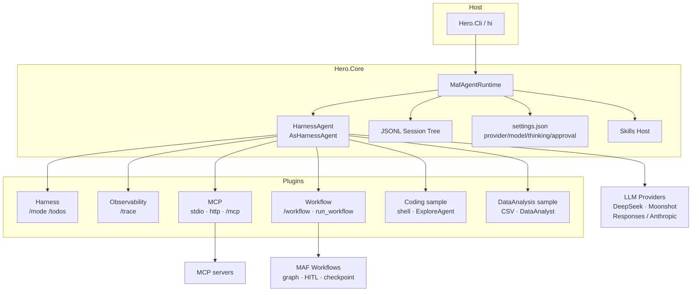
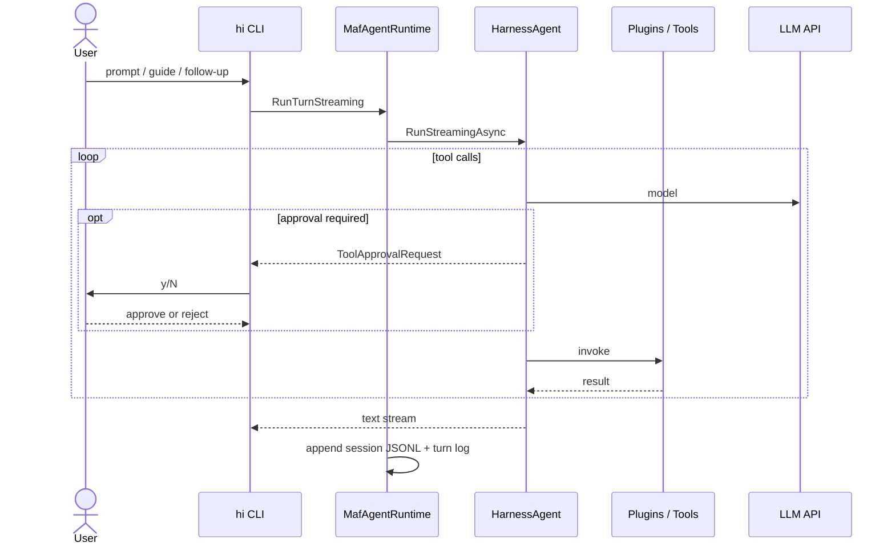
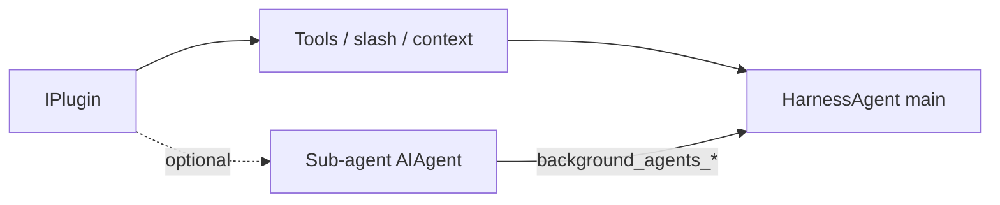

# HERO — Harness for Extensible Runtime Orchestration

[中文](./README-zh.md)

**HERO** is a **plugin-based Agent runtime on .NET**: interactive turns use the **MAF Harness Agent**, multi-step orchestration uses **MAF Workflows**, capabilities mount via **plugins**, and the loop is **observable end-to-end**. Built on the official [Microsoft Agent Framework](https://learn.microsoft.com/agent-framework/overview/agent-framework-overview) — not a reimplementation of its agent loop or graph engine.

UX inspired by [Pi](https://pi.dev/); interactive chat uses [`AsHarnessAgent`](https://learn.microsoft.com/agent-framework/concepts/harness). Not a TypeScript port of Pi. The console host is `hi`.

**Shape:** Core is a thin socket (session tip tree, convention prompts, Skills, plugin contracts). Host code is presentation and wiring; orchestration stays in MAF. Interactive REPL uses Terminal.Gui; print/redirected paths use plain Console (optional TTY colors); `--json` stays a plain event stream.

## Capabilities

| Area | What ships today |
|------|------|
| Interactive agent | MAF `AsHarnessAgent` — tools, plan/todo/mode, loop, compaction |
| Multi-step graphs | MAF Workflows — `Plan → approve → Research(AIAgent) → Summarize` (`/workflow`, `run_workflow`) |
| HITL | Tool approval via Harness `ToolApprovalAgent`; workflow plan approval via `RequestPort` |
| Plugins | Runtime: Harness · Observability · MCP · Workflow · Sample: Coding · DataAnalysis |
| Observability | Turn logs, `/trace`, HTML export, `--json` JSONL event stream |
| Session | JSONL tip tree, branch/checkout, continue (`-c`), export |
| Skills | Harness `AgentSkillsProvider` — catalog in context, bodies via `load_skill` (on demand) |
| File memory | `~/.hero-agent/memory/<cwd-key>/` via Harness `file_memory_*` (on demand; sibling of sessions/logs) |
| Compaction | Auto (`ContextWindowCompactionStrategy`) + manual `/compact [turns]` |
| MCP | Official MCP client (stdio / HTTP), fail-soft |
| Models | DeepSeek (OpenAI Responses) · Moonshot (Anthropic Messages); `Chat:Protocol` |
| Install | `dotnet tool` (`hi`) · Docker (`-p` / `--json`) |

## Why

CLI and coding agents need a **runtime**, not another chat bot: plug in tools, keep a resumable session tree, observe each turn, approve dangerous calls, and run predefined multi-step graphs when the path is known. HERO is that host on .NET + MAF — extend with plugins without reinventing Harness or Workflows.

## Design decisions

| Choice | Why |
|------|------|
| Built on MAF (Harness + Workflows) | Agents for open conversation; Workflows for predefined steps — official split |
| Official `AsHarnessAgent` | Reuse plan/todo/loop/compaction/tool approval instead of a custom agent loop |
| Workflows stay out of the REPL loop | Agent turns are a loop, not a graph; `/workflow` is an added capability |
| JSONL tip tree under `~/.hero-agent/sessions/` | Pi-like branchable history; easy to inspect and export |
| API keys never on disk | Env vars or `/model` process memory only |
| Core = socket, plugins = capability | Keep the product composable and extensible |

## Architecture



### One turn (simplified)



**Plugins compose — they don't just sit side by side.** Everything a plugin adds lands in shared abstractions owned by Core: one decorated `IChatClient`, one tool registry, one context-provider pipeline, one session, one approval policy. Because `Observability` wraps the chat client, it traces sub-agents and workflow nodes it was never told about; because MCP tools are discovered during warmup, they are merged before the agent is built. That is what turns several capabilities into one interactive agent.

### Plugins ≠ Agents · capability ≠ only Tools

A plugin is an **`IPlugin` capability pack**, not an agent. There is one interactive agent: **HarnessAgent**. Plugins contribute into it via `IPluginBuilder`:

| Contribution | What it is | When to use |
|------|------|------|
| `AddTool` | Function the **main** agent can call | One shot / tool loop is enough (`read_file`, `run_shell`, MCP tools, `run_workflow`) |
| `AddSlashCommand` | Human CLI command (`/trace`, `/mcp`, `/workflow`) | Host UX, not model tools |
| `AddContextProvider` / `AppendInstructions` | Extra context or system text | Env blocks, plugin tips |
| `AddChatClientDecorator` | Wrap the chat pipeline | Tracing, transport fixes |
| `AddSkillsRoot` | Skill catalog root | Optional skill directories |
| `AddSubAgent` | Extra **`AIAgent`** for Harness BackgroundAgents | Need a **different persona + tool subset + own multi-step loop**, then return a summary to the parent |

**Rule of thumb:** if it fits one tool call (or the main agent's tool loop), mount a tool. Only add a sub-agent when you need a specialist that must not pollute the parent transcript (sample: **ExploreAgent**, **DataAnalyst**). Observability / Harness / MCP plugins often ship **zero** sub-agents.



### Orchestration (Workflows) — yes, we use it

HERO uses **two MAF orchestration styles** on purpose:

| Style | MAF piece | Role in HERO |
|------|------|------|
| Open / interactive | **HarnessAgent** (agent loop) | REPL turns, tools, HITL tool approval, plan/todo, compaction |
| Predefined multi-step | **Workflows** (`WorkflowBuilder` graph) | Opt-in graph: `Plan → approve → Research → Summarize` |

Workflows are **not** the REPL. They mount as the Workflow plugin: enable with `.hero-agent/workflow.json` (`"enabled": true`), then `/workflow <task>` or tool `run_workflow`. Idle (no config) → silent, no tool. Graph HITL uses Workflow `RequestPort` (plan `y/N`), separate from tool-approval HITL.

## Built on Microsoft Agent Framework

HERO is a product host on the official Microsoft Agent stack — orchestration stays in MAF; this repo wires CLI, session, and plugins.

| Microsoft component | Where HERO uses it | Why this choice |
| --- | --- | --- |
| **Microsoft.Extensions.AI** (`IChatClient`, `AIFunction`, chat-client middleware, `UsageDetails`) | `ChatClientFactory`; plugin tools via `AIFunctionFactory`; `TracingChatClient` decorator; token deltas from `UsageDetails` | One chat/tool surface across providers and plugins; usage comes from the MEAI pipeline instead of scraping provider-specific payloads |
| **Microsoft.Agents.AI** (`AIAgent`, `ChatClientAgent`, `AgentSession`, `AIContextProvider`) | `MafAgentRuntime` session; sample/workflow sub-agents via `AsAIAgent` / `ChatClientAgentOptions`; plugin `AIContextProvider` registration | Agent identity and turn session stay in MAF types; plugins inject context without owning the agent loop |
| **Microsoft.Agents.AI.Harness** (`AsHarnessAgent` — plan/todo/loop/compaction/`ToolApprovalAgent`/BackgroundAgents) | `MafAgentRuntime` builds the interactive agent | Reuse the official plan/todo/loop, compaction, tool approval, and background agents — avoid inventing a second agent loop |
| **Microsoft.Agents.AI.OpenAI** (Responses API) | `GetResponsesClient().AsIChatClient` for OpenAI-compatible providers | Responses is the supported tool-calling path for modern gateways; stay off legacy Chat Completions |
| **Microsoft.Agents.AI.Tools.Shell** (`LocalShellExecutor`) | Coding sample plugin shell tool | Reuse the official shell executor with built-in timeout and working-directory constraints |
| **Microsoft.Extensions.Hosting / DI / Options / Configuration** | `Host.CreateApplicationBuilder` in CLI; Core `ServiceCollectionExtensions` and options configurators | Standard .NET host lifecycle and typed options instead of ad-hoc config and service wiring |
| **ModelContextProtocol** (MCP client) | `Hero.Plugins.Mcp` / `McpSessionHost` | Speak the official MCP client protocol so external servers contribute tools without a custom transport stack |
| **Microsoft.NET.Test.Sdk + xunit** | `Hero.Core.Tests` | Deterministic unit tests on the default .NET test stack reviewers already know |

## Install

### dotnet tool (preferred)

From a local pack (after cloning):

```powershell
dotnet pack src/Host/Hero.Cli/Hero.Cli.csproj -c Release
dotnet tool install --global --add-source ./nupkg Hero.Cli
hi --help
```

Uninstall: `dotnet tool uninstall --global Hero.Cli`.

Or run from source without installing:

```powershell
dotnet run --project src/Host/Hero.Cli
```

### Docker

Container use is aimed at **`-p` / `--json`** (interactive REPL is a poor fit). The image has no Node/`npx`, so **MCP stdio servers are limited** inside the container. Mount `~/.hero-agent` for settings/sessions:

```powershell
docker build -t hero .
docker run --rm -e DEEPSEEK_API_KEY -v ${HOME}/.hero-agent:/root/.hero-agent hero -p "hello" --json
```

On Windows PowerShell, use `$env:USERPROFILE\.hero-agent` instead of `${HOME}/.hero-agent` if needed.

## Quick start

```powershell
git clone https://github.com/lizhonghai99/hero-runtime.git
cd hero-runtime
$env:DEEPSEEK_API_KEY = "sk-..."
# optional: $env:MOONSHOT_API_KEY = "..."

dotnet build Hero.slnx
dotnet test tests/Hero.Core.Tests
dotnet run --project src/Host/Hero.Cli
# or: pack + `dotnet tool install --global --add-source ./nupkg Hero.Cli` then `hi`
```

Working directory = the shell cwd when you start `hi` (`cd` first).

| Provider | Env | Default protocol |
|------|------|------|
| DeepSeek | `DEEPSEEK_API_KEY` (optional endpoint / model) | `openai-responses` |
| Moonshot | `MOONSHOT_API_KEY` (optional base URL / model) | `anthropic` (`https://api.moonshot.cn/anthropic`) |

Override protocol with `Chat__Protocol` / `Chat:Protocol` (`openai-responses` \| `anthropic`). Moonshot and other Anthropic-compatible gateways need the Anthropic client — OpenAI Responses against an `/anthropic` base URL will hang or fail.

Defaults are stored in `~/.hero-agent/settings.json` (`defaultProvider` / `defaultModel` / `defaultProtocol` / `defaultThinkingLevel` / `toolApproval`). **API keys are never written to disk.** Inspect with `/settings`.

## Commands

```text
hi                         new session (archives previous current.jsonl)
hi -c / --continue         resume tip for this directory
hi -p "prompt"             print mode: one turn, then exit
hi -p "prompt" --json      print mode as JSONL event stream (stdout)
hi --no-harness            disable todo/mode/loop
hi --tool-approval shell   require approval for run_shell (default shell; off|shell|all|auto)
hi --yes / -y              auto-approve tool prompts (explicit opt-in)
hi --trust-project-mcp     trust project .hero-agent/mcp.json (stdio spawns processes)
hi --export [path]         export tip tree (JSON + Markdown) and exit
hi --help
```

### REPL highlights

| Input | Effect |
|------|------|
| Text + Enter | One turn |
| Enter while busy | **Steer** — cancel turn, then rerun with the new message (Pi-style) |
| `Alt+Enter` / `Ctrl+Q` / `+ text` | **Follow-up** queue (runs after the current turn) |
| `Esc` while busy | Abort turn and restore queued text to the editor |
| `Shift+Enter` / `Ctrl+J` | Newline in the multiline editor |
| `Ctrl+L` / `/model` | Provider → key (memory) → live official model list |
| `Ctrl+P` / `Alt+P` | Cycle model forward / backward |
| `Shift+Tab` / `/reasoning` | Thinking level (persisted) |
| `Ctrl+G` | External editor (`$VISUAL` / `$EDITOR` / Notepad / nano) |
| `Ctrl+C` | Clear editor; if empty, quit (TUI). Cancels turn when one is running (console) |
| `/hotkeys` | List interactive shortcuts |
| `/approval [mode]` | `off` \| `shell` \| `all` \| `auto` (saved; restart `hi` to rebind tools) |
| `/export [path]` | Export tip tree to JSON + Markdown |
| `/export --html [path]` | Export session + traces as self-contained HTML (`~/.hero-agent/exports/`) |
| `/settings` `/new` `/tree` | Settings / new session / session tree |
| `!cmd` / `!!cmd` | Shell in cwd (AI sees / AI blind); Windows: pwsh→powershell→cmd; Linux/macOS: bash→sh |
| `@path` | Attach file under cwd on submit (absolute / `..` rejected) |
| `/mode` `/todos` | Harness plan → approve → execute |
| `/trace` `/status` | Last-turn tool/LLM trace · usage bar |
| `/mcp` | List MCP servers (state / tool count); silent if unconfigured |
| `/compact [turns]` | Manual compact live transcript (tool collapse + keep last N turns; default 6) |
| `/workflow` `/workflow <task>` | Status / run multi-step research graph (MAF Workflows) |

Demo script: [DEMO.md](./DEMO.md) · [中文](./DEMO-zh.md).

## Runtime features

Detail behind the [Capabilities](#capabilities) table. Interactive chat stays on Harness; multi-step graphs are Workflows.

### Tool approval (HITL)

Uses **Microsoft Agent Framework Harness**, not a custom approval engine:

| Layer | What |
|------|------|
| MAF | `ApprovalRequiredAIFunction` on tools · Harness `ToolApprovalAgent` (queued prompts + standing rules) · `CreateAlwaysApproveTool(WithArguments)Response` |
| Host (`hi`) | Console four-way prompt, or fail-closed / automation wiring |

- Modes: **`shell`** (default) · **`all`** · **`auto`** · **`off`** (demo/unsafe; banner warns)
- CLI: `hi --tool-approval shell` · REPL: `/approval shell` (then restart to rebind tools)
- Interactive: `[1]` once · `[2]` always tool · `[3]` always args · `[4]` / Enter = reject → mapped to MAF response content
- **`auto` / `--yes`:** Harness `ToolApprovalAgent.AllToolsAutoApprovalRule` (no prompt)
- **Fail-closed default** for non-CLI hosts: reject residual approval requests

### Compaction

- Default **`auto`**: MAF `ContextWindowCompactionStrategy` (tool-result eviction + truncation) before each model call
- Manual: `/compact` or `/compact 8` — MAF `ToolResultCompactionStrategy` + `SlidingWindowCompactionStrategy` on the live transcript (no separate summary agent; next turn persists)
- Status bar shows compaction mode; set `Hero:CompactionMode=none` to disable auto only

### Sub-agents

- Sample plugins register background agents (**ExploreAgent**, **DataAnalyst**) to prove the plugin socket
- Parent uses `background_agents_start_task` → `wait` → `get_task_results` → `clear`

### Observability

- **MAF Harness OpenTelemetry** instrumentation is enabled (attach a `TracerProvider` / exporter when you need APM)
- CLI-local presentation (Observability plugin): turn JSONL under `~/.hero-agent/logs/<key>/turns.jsonl`, per-call `traces.jsonl` (includes `agentName`), `/trace`, HTML export
- `/trace` and HTML are host UX on top of a thin `IChatClient` decorator — not a replacement for Harness OTel

### JSON output

Machine-readable one-turn stream for scripts, CI, and future Web/Desktop trace viewers. Requires print mode (`-p`).

```powershell
hi -p "用 shell 数一下 src 下的 .cs" --json | jq .
```

Stdout is **JSONL only** (one event per line, camelCase):

| `type` | Fields |
|------|------|
| `text` | `text` |
| `tool` | `text` |
| `usage` | `input`, `output`, `total`, `cached` |
| `approval` | `text` |
| `error` | `message` |
| `turn_end` | `status` (`ok`\|`error`\|`cancelled`), `durationMs`, token totals, `sessionId` |

Exit codes: `0` ok · `1` error · `130` cancelled. Without `--json`, human print/REPL behavior is unchanged.

### MCP client

- Plugin `Hero.Plugins.Mcp`: connect configured servers and expose tools as `mcp_<server>_<tool>`
- Config: user `~/.hero-agent/mcp.json` always loads; project `.hero-agent/mcp.json` requires **trust** before merge (stdio `command`/`args`/`env` spawns local processes)
- Trust: interactive first-run prompt, stored in `~/.hero-agent/trusted-mcp.json` (content-hash; changes re-prompt); `--json` / non-TTY denies project config; `hi --trust-project-mcp` trusts explicitly
- Untrusted project servers show as `Skipped(untrusted)` in `/mcp` and do not spawn processes
- No config / missing Node → **silent** (does not block `hi` startup); failed servers are skipped
- `/mcp` lists connection state and tool counts

### Workflows

Multi-step **predefined** orchestration uses **Microsoft Agent Framework Workflows** (`WorkflowBuilder` + executors + edges). The interactive chat loop stays on **HarnessAgent** (`AsHarnessAgent`) — agent turns are a loop, not a graph.

| Piece | What |
|------|------|
| Graph | `Plan` → `approve` (`RequestPort`) → `Research` (`AIAgent` node) → `Summarize` |
| HITL | Workflow request/response (not tool-approval): console `y/N` on the plan; `--yes` / `toolApproval=auto` / `autoApprove` skip the prompt |
| Entries | `/workflow <task>` · tool `run_workflow(task)` |
| Config | `.hero-agent/workflow.json` with `"enabled": true` (optional `checkpoint`, `timeoutSeconds`, `autoApprove`) |
| Idle | Missing / not enabled → **silent** (no tool); `/workflow` still reports status |

```json
{ "enabled": true, "checkpoint": true, "timeoutSeconds": 300 }
```

## Layout

```text
src/Core/Hero.Core                 runtime + HarnessAgent wiring
src/Host/Hero.Cli                  console host hi (dotnet tool + Docker entry)
src/Plugins/Hero.Plugins.*         runtime plugins + sample plugins (see below)
tests/Hero.Core.Tests              unit tests
templates/                         convention file samples
samples/data/                      demo CSV
.github/workflows/ci.yml           build + test
Dockerfile                         -p / --json oriented image
```

| Kind | Plugins |
|------|------|
| Runtime | Harness · Observability · MCP · Workflow |
| Sample (prove extensibility) | Coding · DataAnalysis |

```csharp
AddHeroAgent(p => p
    .UseObservabilityPlugin()
    .UseHarnessPlugin()
    .UseCodingPlugin()       // sample
    .UseDataAnalysisPlugin() // sample
    .UseMcpPlugin()
    .UseWorkflowPlugin());
```

## Conventions

| File | Role |
|------|------|
| `.hero-agent/SYSTEM.md` | Main agent persona |
| `.hero-agent/agents/<Name>.md` | Sub-agent prompts |
| `.hero-agent/mcp.json` | MCP servers (stdio / HTTP); optional |
| `.hero-agent/workflow.json` | Enable MAF research workflow (`enabled`); optional |
| `AGENTS.md` | Project notes appended to the prompt |
| `.hero-agent/skills/<name>/SKILL.md` | Agent Skills |

Lookup order: **project cwd → plugin skill roots → `~/.hero-agent/`**.

## Session, memory & control

These are first-class runtime concerns (Pi-style harness), not afterthoughts.

### Memory (conversation)

- **Working memory** = the MAF session at the current **tip**: each turn appends a tree node (`human` + full MAF snapshot) under `current.jsonl`.
- Continuity is the session tip tree; light **file memory** (`file_memory_*`) is optional notes under `~/.hero-agent/memory/` — not a vector DB.
- API keys entered via `/model` stay **in process memory only** (never written to disk).

### Storage (on disk)

| Path | What |
|------|------|
| `~/.hero-agent/sessions/<cwd-key>/current.jsonl` | Session tree + tip (active branch) |
| `…/sessions/<cwd-key>/archive/*.jsonl` | Previous trees after `hi` / `/new` |
| `~/.hero-agent/logs/<cwd-key>/turns.jsonl` | Per-turn observability (tokens, etc.) |
| `~/.hero-agent/memory/<cwd-key>/` | Harness file memory (on-demand notes) |
| `~/.hero-agent/settings.json` | Defaults: provider / model / protocol / thinking / approval (**no secrets**) |
| `~/.hero-agent/logs/<cwd-key>/traces.jsonl` | Per-call tool/LLM traces (`/trace`, HTML export) |

Keyed by working directory so each project keeps its own tree. Export anytime with `/export` or `hi --export`.

### Interrupt & resume

| Action | Behavior |
|------|------|
| `hi -c` / `--continue` | Reload this directory’s tip and keep chatting |
| `/tree` / `/tree <id>` | Inspect tree or checkout a node (branch) |
| `/new` or plain `hi` | Archive `current.jsonl`, start a fresh tip |
| `Ctrl+C` | **Cancel** the in-flight turn (hard interrupt) |
| Type while running | **Guide** — does **not** cancel; applied after the turn |
| `+ text` / `Alt+Enter` | **Follow-up** queued for the next turn |

Short Q&A fixed tax ≈ **3.8k** input tokens; `--no-harness` ≈ **2.6k**.

## License & deps

Some packages are preview/RC — see `Directory.Packages.props`. License: MIT.
